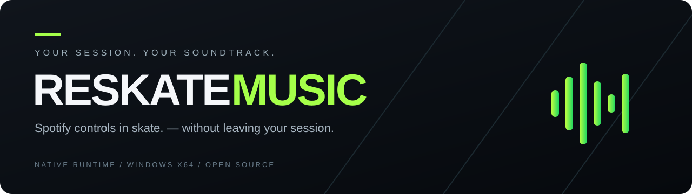

<div align="center">



**Spotify at your fingertips. Keep skating.**


[Features](#features) · [Installation](#installation) · [Spotify setup](#spotify-setup) · [Development](#development) · [Compatibility](#compatibility)

</div>

---

ReskateMusic brings Spotify controls into **skate.'s pause menu**, with a small translucent now-playing card in the bottom-right corner. Built on [ReSkate](https://github.com/Dingo-Shenanigans/ReSkate), it uses the existing native runtime and Windows media controls. Spicetify is not required.

> **Experimental release.** The Windows runtime compiles and input validation tests pass. Live gameplay, controller interaction and authenticated Spotify requests have not yet been verified. This project currently ships a custom `ReSkate.dll` replacement.

## Features

| In your pause menu | On your screen |
| :--- | :--- |
| Play, pause, previous and next | Compact song title and artist |
| Playlist and Liked Songs browsing | Transparent background |
| Song and artist search | Now-playing and paused status |
| Play search results and add them to your queue | Input passes through to the game |
| Queue display, shuffle and repeat | Saved visibility preference |
| Seek by seconds and adjust routed music volume | Scaling for different screen sizes |

## Installation

1. Obtain the runtime package and its matching source package from a maintainer build, or [build locally](#development). GitHub Actions also produces downloadable build artifacts.
2. Extract `ReskateMusic-0.1.zip` and close Skate.
3. Run the installer from the extracted `ReskateMusic` folder:

   ```powershell
   .\Install.ps1 -ReSkateFolder 'C:\Games\ReSkate'
   ```

4. Launch through your existing ReSkate launcher. Open **Pause → Mod Options → Music**.

The installer checks the game's executable hash, backs up your original DLL and launcher settings, then disables launcher auto-updates to preserve the custom runtime. Keep your matching launcher and support files. This package belongs beside `Skate.exe`, rather than in the `Mods` folder.

<details>
<summary><strong>Restore the original runtime</strong></summary>

Close Skate. Copy your saved `ReSkate.dll.backup-…` over `ReSkate.dll`. Restore the backed-up `ReSkateLauncher.settings.json` to restore your previous update settings. Your backups live beside the originals.

</details>

## Spotify setup

**Basic controls:** open Spotify on this PC and start a song. Windows media sessions supply playback controls and the now-playing information without an API sign-in.

**Search, library and advanced controls:**

1. Register your own application in the [Spotify developer dashboard](https://developer.spotify.com/dashboard).
2. Set its redirect URI to `http://127.0.0.1:47824/callback`.
3. Choose **Spotify setup / sign in** in the Music section, enter the client ID and sign in through your browser.
4. Keep desktop Spotify as the active playback device so its metadata matches the overlay.

No client secret is needed. The inherited account integration uses PKCE and Windows DPAPI for saved refresh credentials. Spotify API playback actions require an active device and [Spotify Premium](https://developer.spotify.com/documentation/web-api/reference/start-a-users-playback).

Select the **Spotify tile in the game's music screen** to route audio through the game. The Music section's volume control adjusts that routed audio. Enter a search or a position in seconds, then press **Enter** to submit it.

## Compatibility

| Component | Target |
| :--- | :--- |
| Operating system | Windows x64 |
| Skate Steam build | `25414733` |
| ReSkate source | [`6c45e966`](https://github.com/Dingo-Shenanigans/ReSkate/commit/6c45e9666dcdea6577248f6ab7f3111de48b6039) |
| Integration | Custom native runtime replacement |

This is a music player integration. Playlist editing, recommendations, album/artist pages, podcasts and Spotify account management are not implemented. The inherited library fetch returns up to **50 playlists** and **50 tracks per playlist**; search returns **10 matches**. Development-app permissions can further restrict Spotify access. API playback commands act on your account's active device.

<details>
<summary><strong>Troubleshooting</strong></summary>

- **No song card:** start playback in desktop Spotify and enable the now-playing overlay in the Music section.
- **Empty library:** check the client ID, redirect URI and sign-in, then refresh the library.
- **Playback API error:** check Premium, the active Spotify device and your app's account access.
- **Volume has no effect:** select the Spotify tile in the game's music screen to enable routed audio.
- **Music section disappeared:** a launcher update may have replaced the custom runtime. Check compatibility before reinstalling.

</details>

## Development

Install **Git**, **CMake 3.24+**, and **Visual Studio 2022** with Desktop development with C++ and a Windows SDK. Run from a shell where `cmake` and `ctest` are available:

```powershell
# Validate inputs, fetch the pinned upstream source and build the runtime.
.\tools\Build.ps1

# Run the focused tests without building ReSkate.
.\tools\Build.ps1 -TestOnly
```

The build script places upstream source and its build outputs in `%LOCALAPPDATA%\ReskateMusic\build-cache`, overlays this repository's changed files, and builds an x64 Release runtime. It produces runtime and complete corresponding source ZIPs under `dist/`. The first build requires network access and can take several minutes.

```text
ReskateMusic/
├── .github/workflows/     Windows build and artifact upload
├── assets/               README artwork
├── src/                  Modified and added ReSkate source files
├── tests/                Spotify input validation
├── tools/                Build and installation scripts
├── LICENSE               GPL-3.0 license
└── README.MD             Project documentation
```

`src/` preserves upstream-relative paths. When changing the upstream pin, review native UI contracts and the supported game identity together. The workflow builds pull requests and pushes; generated binaries, caches and logs are excluded from Git.

### Verification

- MSVC x64 Release compilation and linking passed for the initial runtime.
- Fourteen input checks passed for Spotify track URI validation and allowed shuffle/repeat values.
- Installer syntax and installed binary hashes were verified against the supported game build.
- In-game rendering, controller interaction and authenticated Spotify API behavior remain untested.

### Contributing

Keep changes focused, run the tests and relevant build, and describe the behavior and validation in your pull request. For game issues, include the game build, ReSkate version and reproduction steps. Remove tokens, account information and other private data from logs before sharing them.

## Credits & license

Built on **[ReSkate](https://github.com/Dingo-Shenanigans/ReSkate)** by Dingo-Shenanigans and its contributors. Its existing music, Spotify, audio capture and pause-menu infrastructure make this extension possible.

Distributed under **[GPL-3.0](LICENSE)**. When distributing a built runtime, include the complete corresponding source package produced by the build script and preserve upstream and dependency license notices.

This fan project is not affiliated with Electronic Arts, Full Circle or Spotify.
